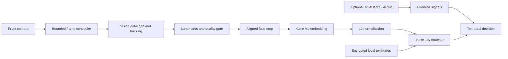

# LocalFaceKit

[](https://github.com/junsik-1/LocalFaceKit/actions/workflows/ci.yml)
[](https://swift.org)
[](LICENSE)

Privacy-first, on-device face detection and recognition building blocks for iPadOS.

[한국어 문서](README.ko.md)

LocalFaceKit is an open-source Swift package for building face detection, landmark extraction, embedding, verification, and identification workflows without sending camera frames or biometric templates to a server.

> [!WARNING]
> LocalFaceKit is an early-stage project. It is not Apple Face ID, does not access Face ID enrollment data, and must not be used as the only factor for high-risk authentication.

## Project status

Implemented:

- Vision face rectangle and landmark analysis
- Core ML embedding model adapter
- Unit-normalized face embeddings
- 1:1 verification and 1:N identification
- Threshold and runner-up margin policies
- Multi-sample enrollment templates
- AES-GCM encrypted template persistence
- device-local Keychain key generation
- privacy manifest and automated tests

Planned:

- camera frame source and bounded frame scheduler
- five-point face alignment and quality gates
- temporal consensus over live frames
- optional synchronized TrueDepth input
- optional ARKit pose and challenge-response liveness signals
- iPad demo application and on-device benchmarks

The repository intentionally contains **no pretrained face model or real face dataset**. Model weights require their own redistribution and data-provenance review.

## Requirements

- iPadOS 17+
- Swift 6+
- Xcode 16+
- A12 Bionic or newer recommended for real-time embedding
- a physical iPad for camera, ARKit, and performance testing

macOS 14+ is supported for library tests and offline development.

## Installation

Add the package in Xcode, or include it in `Package.swift`:

```swift
dependencies: [
    .package(
        url: "https://github.com/junsik-1/LocalFaceKit.git",
        from: "0.1.0"
    )
]
```

Add a camera usage description to the host application's `Info.plist`:

```xml
<key>NSCameraUsageDescription</key>
<string>Camera frames are processed on this device for face detection.</string>
```

## Quick start

### Detect faces and landmarks

```swift
import ImageIO
import LocalFaceKit

let analyzer = VisionFaceAnalyzer()
let faces = try await analyzer.analyze(
    pixelBuffer: cameraPixelBuffer,
    orientation: .leftMirrored,
    includeLandmarks: true
)

for face in faces {
    print(face.boundingBox, face.landmarks?.leftEye ?? [])
}
```

Vision bounding boxes use normalized image coordinates. Keep inference orientation separate from preview mirroring and test every supported iPad orientation.

### Load a Core ML embedding model

The input face must already be cropped, aligned, and resized to the model's declared image input size.

```swift
import LocalFaceKit

let embedder = try CoreMLFaceEmbedder(
    modelURL: compiledModelURL,
    modelIdentifier: "mobileface-112-v1",
    inputName: "image",
    outputName: "embedding"
)

let embedding = try await embedder.embedding(for: alignedFacePixelBuffer)
```

See [Models/README.md](Models/README.md) for the model contract and licensing rules.

### Enroll and verify locally

```swift
import LocalFaceKit

let store = InMemoryTemplateStore()
let policy = try MatchingPolicy(threshold: calibratedThreshold)
let service = FaceRecognitionService(
    modelIdentifier: "mobileface-112-v1",
    store: store,
    matchingPolicy: policy
)

try await service.enroll(
    subjectID: "random-local-id",
    embeddings: enrollmentEmbeddings
)

let result = try await service.verify(
    queryEmbedding,
    claimedSubjectID: "random-local-id"
)
```

There is no universal similarity threshold. Calibrate it for the exact model, preprocessing pipeline, target population, and required false-accept rate.

### Persist encrypted templates

```swift
import LocalFaceKit

let key = try KeychainKeyStore.loadOrCreateKey(
    service: "com.example.myapp.localface"
)
let store = EncryptedFileTemplateStore(
    fileURL: applicationSupportURL.appendingPathComponent("faces.enc"),
    key: key
)
```

The encrypted file is excluded from backup where possible, and the key uses `WhenUnlockedThisDeviceOnly`. The host app remains responsible for user consent, deletion UI, retention rules, and access control.

## Architecture



The production design uses mutually exclusive capture backends:

- `AVFoundation + Vision` for all supported iPads
- synchronized `AVFoundation RGB + depth` when actual TrueDepth data is needed
- `ARKit` when face pose, mesh, or blend-shape signals are needed

See [docs/ARCHITECTURE.md](docs/ARCHITECTURE.md) for module boundaries and the full data flow.

## Privacy and security

- no networking or analytics dependency
- no cloud API
- no model download at runtime
- no source image persistence by the package
- encrypted biometric templates
- pseudonymous subject identifiers recommended
- explicit deletion supported

Face embeddings are biometric data even when the original image cannot be trivially reconstructed. Read [PRIVACY.md](PRIVACY.md) and [SECURITY.md](SECURITY.md) before integrating the package.

For sensitive actions, gate the result with Apple's `LocalAuthentication` or another independent factor. RGB or depth liveness heuristics do not guarantee protection against presentation attacks.

## Development

```bash
swift test
```

Do not add real face images, production biometric templates, or ambiguously licensed model weights to issues, fixtures, or pull requests.

## Contributing

Contributions are welcome. Start with [CONTRIBUTING.md](CONTRIBUTING.md), and use the private process in [SECURITY.md](SECURITY.md) for vulnerabilities.

## License

Source code is available under the [Apache License 2.0](LICENSE). Models, datasets, and sample media have separate licenses and are not covered merely because they are used with this package.
