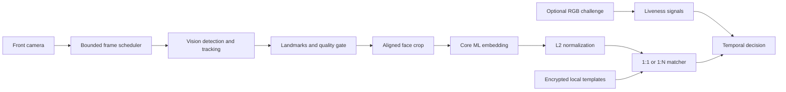

# LocalFaceKit

[](https://github.com/junsik-1/LocalFaceKit/actions/workflows/ci.yml)
[](https://swift.org)
[](LICENSE)

Privacy-first, RGB-only face detection and recognition building blocks for iPads without Face ID.

[한국어 문서](README.ko.md)

LocalFaceKit is an open-source Swift package for building face detection, landmark extraction, embedding, verification, and identification workflows on iPads with an ordinary front RGB camera. Camera frames, models, templates, and decisions remain local to the application sandbox.

> [!WARNING]
> LocalFaceKit is an early-stage project for iPads without Face ID hardware. It uses only the ordinary front RGB camera and must not be used as the only factor for high-risk authentication.

## Project status

Implemented:

- Vision face rectangle and landmark analysis
- five-point similarity alignment with orientation handling
- configurable face-count, size, pose, illumination, and sharpness gates
- end-to-end Vision → alignment → Core ML embedding pipeline
- Core ML embedding model adapter
- Unit-normalized face embeddings
- 1:1 verification and 1:N identification
- Threshold and runner-up margin policies
- Multi-sample enrollment templates
- AES-GCM encrypted template persistence
- device-local Keychain key generation
- privacy manifest and automated tests
- bounded ordinary front RGB camera stream
- SwiftUI face-scanning screen with progress, guidance, and result states
- CI guard that rejects runtime networking APIs

Planned:

- temporal consensus over live frames
- optional RGB challenge-response liveness signals
- iPad demo application and on-device benchmarks

The repository intentionally contains **no pretrained face model or real face dataset**. Model weights require their own redistribution and data-provenance review.

## Requirements

- iPadOS 17+
- Swift 6+
- Xcode 16+
- A12 Bionic or newer recommended for real-time embedding
- a physical iPad with a front RGB camera for camera and performance testing

macOS 14+ is supported for library tests and offline development.

## Installation

Add the package in Xcode, or include it in `Package.swift`:

```swift
dependencies: [
    .package(
        url: "https://github.com/junsik-1/LocalFaceKit.git",
        from: "0.3.0"
    )
]
```

Add a camera usage description to the host application's `Info.plist`:

```xml
<key>NSCameraUsageDescription</key>
<string>Camera frames are processed on this device for face detection.</string>
```

The package deliberately discovers only front wide-angle or ultra-wide RGB cameras. It never selects a TrueDepth camera.

## Quick start

### Detect faces and landmarks

```swift
import ImageIO
import LocalFaceKit

let analyzer = VisionFaceAnalyzer()
let faces = try await analyzer.analyze(
    pixelBuffer: cameraPixelBuffer,
    orientation: .leftMirrored,
    includeLandmarks: true
)

for face in faces {
    print(face.boundingBox, face.landmarks?.leftEye ?? [])
}
```

Vision bounding boxes use normalized image coordinates. Keep inference orientation separate from preview mirroring and test every supported iPad orientation.

### Stream ordinary front RGB frames

```swift
let camera = try RGBFrontCameraSource.make()
guard await RGBFrontCameraSource.requestAccess() else { return }

try await camera.start()
for await frame in camera.frames {
    let faces = try await analyzer.analyze(pixelBuffer: frame.pixelBuffer)
    // Process locally. Do not retain the source frame.
}
```

### Present the face-scanning UI

`FaceScanView` follows the familiar structure of a biometric scan—camera preview, rounded face guide, animated scan line, progress, and a success or retry state—while remaining visually distinct from Apple's system Face ID screen.

```swift
@State private var scanState: FaceScanState = .ready

FaceScanView(
    cameraSource: camera,
    state: $scanState,
    strings: .korean
)
```

Drive the UI from your pipeline:

```swift
scanState = .positioning
scanState = .scanning(progress: 0.65)
scanState = .success
// or: .failure(message: "얼굴을 다시 맞춰주세요")
```

The view never invokes Face ID and does not use Apple's Face ID glyph. It labels the operation as local face verification and displays an on-device-only privacy message.

### Run the quality, alignment, and embedding pipeline

`FaceEmbeddingPipeline` accepts one camera frame, rejects unsuitable frames before inference, aligns an accepted face to the standard five-point reference, and invokes a locally bundled Core ML model. Pass the same orientation to the pipeline that you use for preview-coordinate mapping.

```swift
import ImageIO
import LocalFaceKit

let embedder = try CoreMLFaceEmbedder(
    modelURL: compiledModelURL,
    modelIdentifier: "mobileface-112-v1",
    inputName: "image",
    outputName: "embedding"
)
let aligner = try FivePointFaceAligner(
    outputSize: embedder.inputImageSize.width
)
let quality = FaceQualityEvaluator(policy: .standard)
let pipeline = try FaceEmbeddingPipeline(
    qualityEvaluator: quality,
    aligner: aligner,
    embedder: embedder
)

let result = try await pipeline.process(
    pixelBuffer: cameraPixelBuffer,
    orientation: .leftMirrored
)
if case .accepted(let embedding, let quality) = result {
    print(embedding.values.count, quality.metrics)
}
```

The default aligner emits a square BGRA buffer using the published 112×112 ArcFace reference geometry, scaled to the requested output size. Use it only with a model trained for that exact alignment contract. The model image input size is inspected at load time, and a mismatched aligner is rejected before processing frames.

`FaceQualityPolicy.standard` is an initial engineering policy, not a calibrated security threshold. Validate its pose, illumination, sharpness, and face-size limits on each supported iPad and population.

See [Models/README.md](Models/README.md) for the model contract and licensing rules.

### Enroll and verify locally

```swift
import LocalFaceKit

let store = InMemoryTemplateStore()
let policy = try MatchingPolicy(threshold: calibratedThreshold)
let service = FaceRecognitionService(
    modelIdentifier: "mobileface-112-v1",
    store: store,
    matchingPolicy: policy
)

try await service.enroll(
    subjectID: "random-local-id",
    embeddings: enrollmentEmbeddings
)

let result = try await service.verify(
    queryEmbedding,
    claimedSubjectID: "random-local-id"
)
```

There is no universal similarity threshold. Calibrate it for the exact model, preprocessing pipeline, target population, and required false-accept rate.

### Persist encrypted templates

```swift
import LocalFaceKit

let key = try KeychainKeyStore.loadOrCreateKey(
    service: "com.example.myapp.localface"
)
let store = EncryptedFileTemplateStore(
    fileURL: applicationSupportURL.appendingPathComponent("faces.enc"),
    key: key
)
```

The encrypted file is excluded from backup where possible, and the key uses `WhenUnlockedThisDeviceOnly`. The host app remains responsible for user consent, deletion UI, retention rules, and access control.

## Architecture



The production design has one capture path: `AVFoundation RGB camera → Vision → Core ML`. Depth cameras and ARKit are intentionally outside the project scope.

See [docs/ARCHITECTURE.md](docs/ARCHITECTURE.md) for module boundaries and the full data flow.

## Privacy and security

- no networking or analytics dependency
- no cloud API
- no model download at runtime
- no non-file Core ML model URL
- no source image persistence by the package
- encrypted biometric templates
- pseudonymous subject identifiers recommended
- explicit deletion supported

Face embeddings are biometric data even when the original image cannot be trivially reconstructed. Read [PRIVACY.md](PRIVACY.md) and [SECURITY.md](SECURITY.md) before integrating the package.

For sensitive actions, require a passcode or another independent factor. RGB liveness heuristics do not guarantee protection against presentation attacks.

## Development

```bash
swift test
```

Do not add real face images, production biometric templates, or ambiguously licensed model weights to issues, fixtures, or pull requests.

## Contributing

Contributions are welcome. Start with [CONTRIBUTING.md](CONTRIBUTING.md), and use the private process in [SECURITY.md](SECURITY.md) for vulnerabilities.

## License

Source code is available under the [Apache License 2.0](LICENSE). Models, datasets, and sample media have separate licenses and are not covered merely because they are used with this package.
