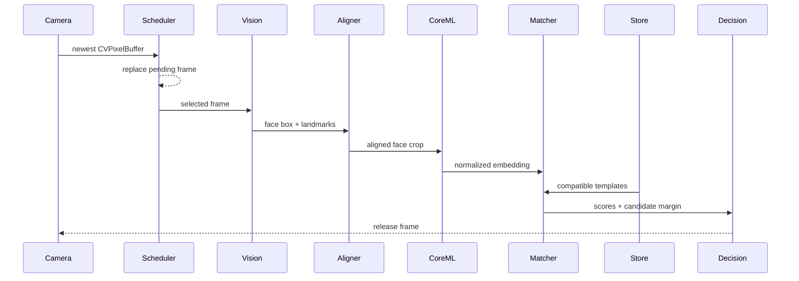

# Architecture

LocalFaceKit separates camera access, face analysis, embedding, matching, liveness signals, and storage so applications can replace a model or sensor backend without migrating unrelated components.

## Design goals

1. Camera frames and biometric templates never require a server.
2. An ordinary front RGB camera is the only capture path.
3. Face ID, TrueDepth, ARKit, cloud APIs, and runtime model downloads are out of scope.
4. Model preprocessing, output dimension, and thresholds are versioned together.
5. Raw frames are ephemeral; only explicitly enrolled embeddings are persisted.
6. Slow analysis never creates an unbounded frame backlog.

## Proposed package boundaries

```text
LocalFaceKit
├── Capture
│   └── RGBFrontCameraSource
├── Vision
│   ├── VisionFaceAnalyzer
│   ├── FaceTracker
│   └── FaceQualityEvaluator
├── Embedding
│   ├── FivePointFaceAligner
│   └── CoreMLFaceEmbedder
├── Matching
│   ├── FaceRecognitionService
│   └── CosineFaceMatcher
├── Liveness
│   └── RGBChallengeEvaluator
├── Storage
│   ├── EncryptedFileTemplateStore
│   └── KeychainKeyStore
└── UI
    ├── RGBFaceCameraView
    ├── FaceScanOverlay
    └── FaceScanView
```

The initial package keeps these components in one target while public APIs settle. They can become separate products if compile time or optional framework linkage warrants it.

## Runtime data flow



The scheduler has a capacity of one pending frame. If inference is busy, the newest frame replaces the older pending frame. A stale frame is never more valuable than a recent one in the live preview.

## Capture backends

### RGB-only capture

Use `AVCaptureVideoDataOutput` with a front wide-angle or ultra-wide RGB camera. `RGBFrontCameraSource` deliberately excludes `.builtInTrueDepthCamera`, keeps only the newest pending frame, and processes buffers on a dedicated serial queue. Detection runs periodically; tracking and a region of interest reduce work between detections.

No alternative capture backend is planned. This keeps behavior consistent on iPads without Face ID hardware.

## Analysis and alignment

Vision produces normalized image-space bounding boxes and landmarks. `FivePointFaceAligner` derives stable eye centers plus nose and mouth anchors, applies a similarity transform, and emits a square BGRA buffer using the standard ArcFace reference geometry. It applies the same image orientation supplied to Vision before mapping landmarks, so analysis and alignment stay in one coordinate system.

`FaceQualityEvaluator` rejects:

- zero or multiple faces during 1:1 enrollment
- faces that occupy too little of the frame
- excessive yaw, pitch, or roll
- clipping, blur, or poor illumination
- missing landmarks required by the five-point transform

The current quality score intentionally does not claim to detect severe occlusion or presentation attacks. Those require separately evaluated signals. Frames that fail an optional RGB challenge-response check will be handled by the future liveness stage.

`FaceEmbeddingPipeline` composes Vision analysis, quality evaluation, alignment, and Core ML inference. A rejected frame never reaches the model. The pipeline verifies that the aligner's square output matches the model's declared image input dimensions before it accepts frames.

Every model package needs metadata for color order, normalization, alignment landmarks, input size, output dimension, model identifier, and calibrated thresholds.

## Enrollment

Enrollment collects multiple accepted samples across small pose and expression changes. A template stores unit embeddings and computes a normalized centroid for matching. It never stores the source camera frame.

The suggested initial policy is 5–10 accepted samples, with capture guidance to avoid collecting near-identical adjacent frames.

## Matching

Verification compares a query against the claimed subject. Identification ranks all compatible subjects. Identification should use a stricter threshold and a minimum margin between the first and second candidates.

Thresholds are evaluation outputs, not constants chosen by intuition. Report false accept rate, false reject rate, and subgroup results for each shipped calibration profile.

Templates from different `modelIdentifier` values are never compared. A changed model, alignment strategy, or normalization contract requires a new identifier and usually re-enrollment.

## Temporal decision

A live decision should combine several recent quality-approved frames—for example, three positive results within the last five eligible frames. Cooldowns prevent one face from emitting repeated application events.

RGB challenge-response signals enter the temporal decision separately from identity similarity. They must not be folded into an undocumented magic score, and they do not prove liveness.

## Concurrency

- camera callbacks must return quickly
- Vision requests are serialized by their actor
- each Core ML model instance is actor-isolated
- UI updates run on `MainActor`
- raw pixel buffers are not retained beyond processing
- cancellation stops capture and releases pending frames

## Storage

`EncryptedFileTemplateStore` serializes versioned templates, encrypts them using AES-GCM, and writes atomically. `KeychainKeyStore` creates a 256-bit key using `WhenUnlockedThisDeviceOnly`.

Applications may additionally require a local passcode before accessing enrollment or deletion controls. That policy belongs to the host application because unattended kiosks and personal devices have different requirements.

## Local-only boundary

The package has no networking dependency or runtime networking API. Core ML models must be supplied as local file URLs, and templates are stored only in memory or in the encrypted application file selected by the host app. CI scans Swift sources for common Apple networking APIs.

The host application can still add network capabilities. A product that promises offline operation must audit its complete dependency graph and must bundle the model in the signed application rather than downloading it after installation.

## Scan UI

`FaceScanView` presents the RGB preview behind a rounded face guide, animated scan line, progress stroke, status guidance, success check, and retry state. The interaction is inspired by familiar biometric enrollment patterns but does not use the Face ID glyph, claim to invoke Face ID, or imitate a system authentication sheet.

The recognition pipeline owns `FaceScanState`. UI state is never treated as proof of identity; it reflects detector quality, embedding progress, temporal consensus, and final policy decisions produced elsewhere.

## Performance targets

Targets must be measured on real supported iPads:

- preview: 30 FPS
- face detection: 10–15 Hz
- embedding: 5–10 Hz per active face
- live result latency: 300–700 ms including temporal consensus
- no steadily growing memory or frame queue

These are engineering targets, not current guarantees.
