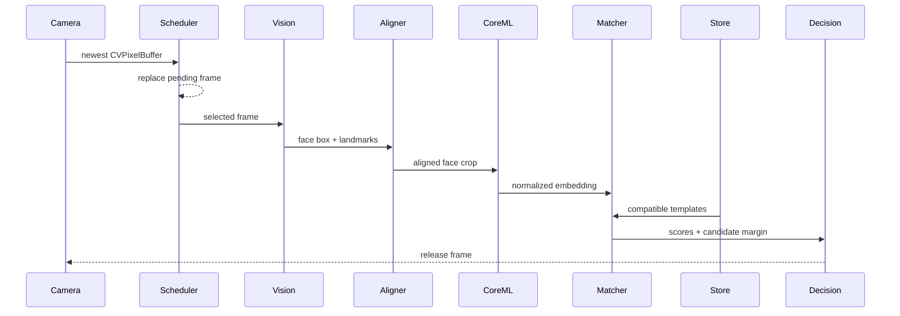

# Architecture

LocalFaceKit separates camera access, face analysis, embedding, matching, liveness signals, and storage so applications can replace a model or sensor backend without migrating unrelated components.

## Design goals

1. Camera frames and biometric templates never require a server.
2. RGB front cameras provide the baseline path on every supported iPad.
3. TrueDepth and ARKit are optional capabilities, not hard dependencies.
4. Model preprocessing, output dimension, and thresholds are versioned together.
5. Raw frames are ephemeral; only explicitly enrolled embeddings are persisted.
6. Slow analysis never creates an unbounded frame backlog.

## Proposed package boundaries

```text
LocalFaceKit
├── Capture
│   ├── AVFoundationCameraSource
│   ├── TrueDepthCameraSource
│   └── ARKitFaceSource
├── Vision
│   ├── VisionFaceAnalyzer
│   ├── FaceTracker
│   └── FaceQualityEvaluator
├── Embedding
│   ├── FivePointFaceAligner
│   └── CoreMLFaceEmbedder
├── Matching
│   ├── FaceRecognitionService
│   └── CosineFaceMatcher
├── Liveness
│   ├── DepthSignalEvaluator
│   └── ARKitChallengeEvaluator
└── Storage
    ├── EncryptedFileTemplateStore
    └── KeychainKeyStore
```

The initial package keeps these components in one target while public APIs settle. They can become separate products if compile time or optional framework linkage warrants it.

## Runtime data flow



The scheduler has a capacity of one pending frame. If inference is busy, the newest frame replaces the older pending frame. A stale frame is never more valuable than a recent one in the live preview.

## Capture backends

### RGB baseline

Use `AVCaptureVideoDataOutput` and the front camera. Set `alwaysDiscardsLateVideoFrames` and process buffers on a dedicated serial executor. Detection runs periodically; tracking and a region of interest reduce work between detections.

### TrueDepth

When actual depth is required, select `.builtInTrueDepthCamera` explicitly and synchronize `AVCaptureVideoDataOutput` with `AVCaptureDepthDataOutput`. Device capability and active depth formats must be checked at runtime.

Depth can reject simple planar presentation attacks, but it is not a proof of liveness and does not reproduce Face ID security.

### ARKit

Use `ARFaceTrackingConfiguration` only when pose, mesh, eye transforms, or blend shapes add value. Consume the camera image from the same AR session rather than starting a competing AVFoundation session.

## Analysis and alignment

Vision produces normalized image-space bounding boxes and landmarks. The alignment stage will derive stable eye centers plus nose and mouth anchors, apply a similarity transform, and emit the model's declared input size—initially 112×112 RGB.

Quality gates should reject:

- zero or multiple faces during 1:1 enrollment
- faces that occupy too little of the frame
- excessive yaw, pitch, or roll
- blur, clipping, severe occlusion, or poor illumination
- inconsistent depth where depth is available

Every model package needs metadata for color order, normalization, alignment landmarks, input size, output dimension, model identifier, and calibrated thresholds.

## Enrollment

Enrollment collects multiple accepted samples across small pose and expression changes. A template stores unit embeddings and computes a normalized centroid for matching. It never stores the source camera frame.

The suggested initial policy is 5–10 accepted samples, with capture guidance to avoid collecting near-identical adjacent frames.

## Matching

Verification compares a query against the claimed subject. Identification ranks all compatible subjects. Identification should use a stricter threshold and a minimum margin between the first and second candidates.

Thresholds are evaluation outputs, not constants chosen by intuition. Report false accept rate, false reject rate, and subgroup results for each shipped calibration profile.

Templates from different `modelIdentifier` values are never compared. A changed model, alignment strategy, or normalization contract requires a new identifier and usually re-enrollment.

## Temporal decision

A live decision should combine several recent quality-approved frames—for example, three positive results within the last five eligible frames. Cooldowns prevent one face from emitting repeated application events.

Liveness signals enter the temporal decision separately from identity similarity. They must not be folded into an undocumented magic score.

## Concurrency

- camera callbacks must return quickly
- Vision requests are serialized by their actor
- each Core ML model instance is actor-isolated
- UI updates run on `MainActor`
- raw pixel buffers are not retained beyond processing
- cancellation stops capture and releases pending frames

## Storage

`EncryptedFileTemplateStore` serializes versioned templates, encrypts them using AES-GCM, and writes atomically. `KeychainKeyStore` creates a 256-bit key using `WhenUnlockedThisDeviceOnly`.

Applications may additionally protect the key with `SecAccessControl` and `LocalAuthentication`. That policy belongs to the host application because unattended kiosks and personal devices have different access requirements.

## Performance targets

Targets must be measured on real supported iPads:

- preview: 30 FPS
- face detection: 10–15 Hz
- embedding: 5–10 Hz per active face
- live result latency: 300–700 ms including temporal consensus
- no steadily growing memory or frame queue

These are engineering targets, not current guarantees.
